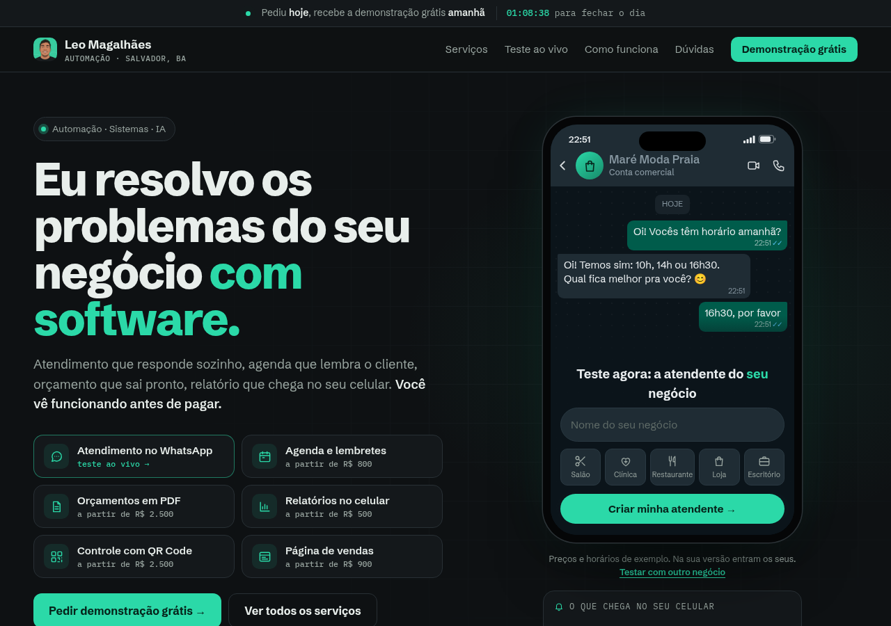
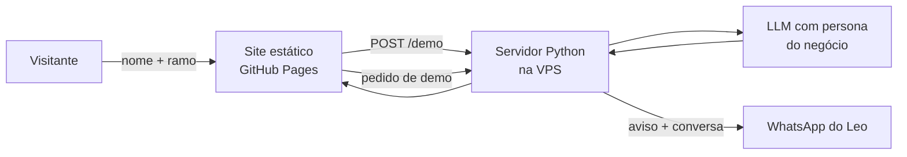

# Atendente de IA ao vivo · site que vira contato no WhatsApp

`NO AR` · **Estudo de caso.** O front-end está no repositório do site; o servidor e os prompts são proprietários.

> *EN: Landing page where visitors type their business name and instantly chat, inside a realistic WhatsApp mock-up, with an AI receptionist built for that business. Leads go straight to WhatsApp.*

**🔗 No ar:** [leomagalhaesti.github.io](https://leomagalhaesti.github.io) · front-end em [leomagalhaesti.github.io](https://github.com/leomagalhaesti/leomagalhaesti.github.io)

---

## O problema

O cliente de um pequeno negócio não entende "atendente com IA" lendo um texto. Ele precisa **ver funcionando com o negócio dele**. Formulário de contato tradicional quase não converte.

## A solução

- O visitante digita o **nome do negócio** e escolhe o ramo (salão, clínica, restaurante, loja, escritório)
- Na hora, um **celular com o WhatsApp** aparece com o nome dele, o ícone do ramo e uma atendente de IA que responde como se trabalhasse lá
- Ele conversa como se fosse o cliente. Quando gosta, pede a **demonstração grátis em 24 h** com nome e WhatsApp
- O pedido chega no meu WhatsApp com a conversa e um botão para montar a demo

## Decisões técnicas

| Desafio | Como resolvi |
|---|---|
| Parecer um chat genérico | Celular realista (barra de status com hora real, "Conta comercial", modo escuro) montado em HTML e CSS |
| Abuso e custo de IA | Limite de mensagens por IP por hora no servidor |
| IA falar preço cedo demais | Trava no servidor: se ninguém perguntou preço e a resposta tem "R$", ela é refeita sem valor |
| IA cair | O site mostra o formulário já preenchido com o que a pessoa escreveu |
| Requisição cross-origin | JSON enviado como `text/plain` (sem preflight CORS) |
| Medir o que funciona | Conversas e pedidos registrados por dia. A versão anterior foi trocada porque os dados mostraram 0 pedidos em 20 conversas |

## Stack

---

Projeto de [Leonardo Magalhães](https://github.com/leomagalhaesti)
